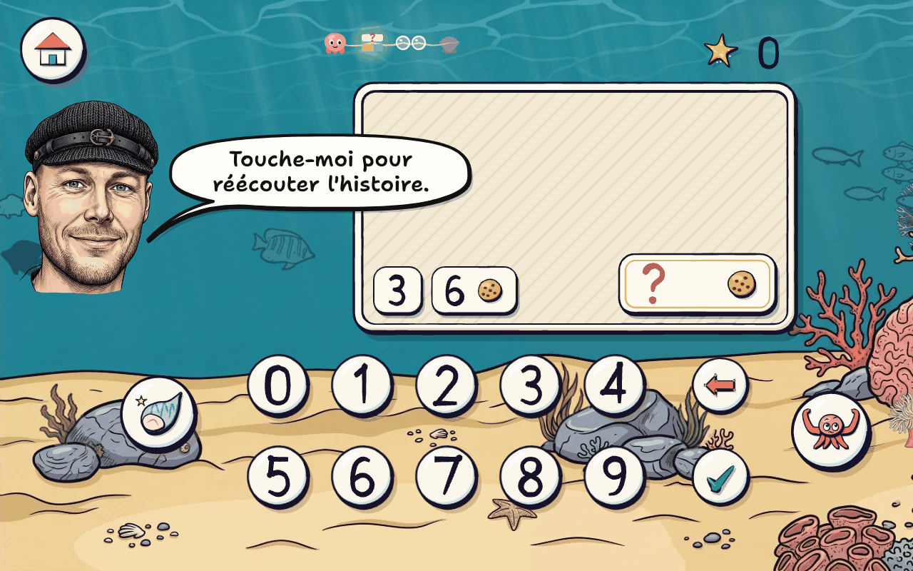
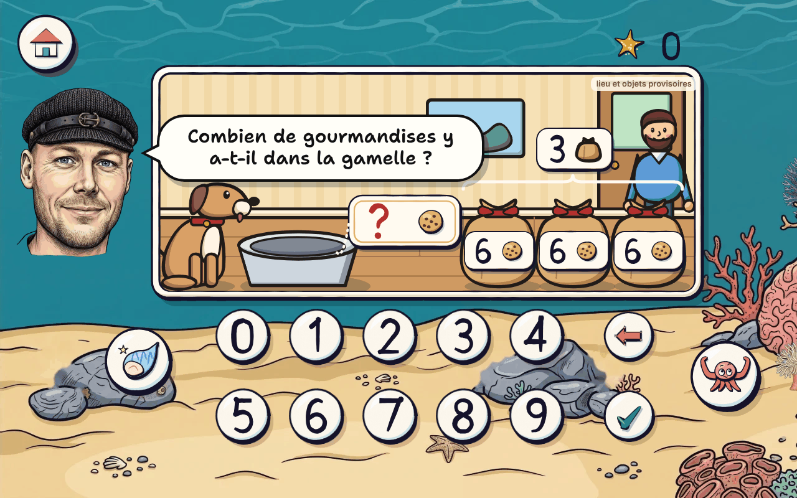

# « Mise en scène des problèmes » : la maquette et les questions à trancher

Maquette préparée après le constat du parent du 5 novembre 2026, **pour validation avant tout code** (règle du 30 septembre, `docs/IDEES.md`, section 1). Rien n'est modifié dans `app/`, ni dans `docs/SPEC.md`, `docs/LOTS.md`, `docs/IDEES.md`, ni dans `art/problemes/contextes.json` : tout ce qui est nouveau est dans `art/problemes/mise-en-scene/` et dans ce dossier.

> **Le constat** : l'écran des problèmes est vide à 80 % (le grand cadre de l'illustration, encore un fond de papier) ; seul le bas sert, presque sans image. « 3 sachets de 6 gourmandises, papa vide tout dans la gamelle du chien » ne montre qu'un petit biscuit.

| Aujourd'hui | Proposé |
| --- | --- |
|  |  |

**En une phrase** : la scène s'agrandit (884 × 374 au lieu de 620 × 350) et se remplit des **objets de l'histoire**, posés par l'application à leur place et **en nombre exact** (Papa, le chien, la gamelle, 3 sachets fermés marqués « 6 ») ; ce qu'on compte (les gourmandises) reste **caché tant que l'enfant doit le trouver par le calcul**, et n'apparaît qu'à la correction.

**Ce qui est livré** :

1. **La mise en page** (section 1) et la maquette de **15 écrans** pour cinq énoncés, plus 3 sur le petit smartphone et l'écran d'aujourd'hui pour comparer (section 4) : `art/problemes/mise-en-scene/index.html`, captures dans ce dossier.
2. **La bibliothèque d'objets** (section 2) : `art/problemes/mise-en-scene/objets.json`, et le **relevé** de tous les objets des 200 énoncés, énoncé par énoncé : **`OBJETS.md`** (par `relever.mjs`).
3. **Les prompts Nano Banana**, la taille et l'endroit où déposer chaque objet (section 3) : **`PROMPTS.md`** ; et les 21 lieux revus pour ce nouveau cadrage (`lieux.json`).
4. **Ce que cela change** à l'aide, à la correction et au partage manipulé (section 5) et **les questions à trancher**, chacune avec une recommandation (section 6).

**Le point le plus important** : les lieux ne sont pas encore générés (sauf l'étal). **Il vaut mieux attendre la validation de cette maquette avant de les générer**, car elle change leur format (21:9 au lieu de 16:9) et leur composition (un sol libre pour y poser les objets, et plus aucun bol, seau ou banc dans l'image : c'est la bibliothèque qui les apporte, en nombre exact). Question 2.

## 1. La mise en page

Tout est mesuré dans la scène de 1280 × 800 de l'application (le petit smartphone la montre réduite, à 0,45).

| Zone | Place | Ce qui change |
| --- | --- | --- |
| La mascotte, la maison, les étoiles, la frise | inchangées | — |
| **La scène** (le cadre de nacre et l'image du lieu) | x 244 à 1128, y 106 à 480 : **884 × 374** ; l'image dedans **860 × 350**, au format 21:9 | aujourd'hui 620 × 350 (x 496 à 1116). Elle part juste à droite de la mascotte et s'arrête au-dessus du pavé (dont les touches commencent à y 490) et à gauche des réserves d'étoiles (x 1136). Sa surface passe de 21 % à 32 % de l'écran, et surtout elle est **pleine** |
| **La bande de la bulle** | dans la scène, en haut à gauche (x < 760, y < 300) | n'y vont que le décor (mur, ciel) et ce qu'on ne touche pas : c'est là que s'écrit la bulle de la mascotte (sa place « droite » d'aujourd'hui). Le prompt des lieux y demande un coin calme |
| **Le sol de la scène** | de y 380 à 466 environ | les objets de l'histoire y ont le pied, à l'échelle commune (un adulte : 250 px, un enfant : 190, le chien : 160, un sachet : 125, une gamelle : 70) |
| **Les étiquettes des données** | **sur l'objet qu'elles décrivent** : « 6 » sur chaque sachet, « 8 » et « 5 » sur le seau, « 23 » sur la glace de l'étal ; le nombre de groupes au-dessus de la rangée, avec l'icône du contenant (« 3 » et un petit sachet) et une accolade | aujourd'hui alignées au bas de l'image. Même dessin, même taille (le nombre en 38 à 39 px), toujours touchables (elles redisent leur phrase), jamais dans la bande de la bulle |
| **La plaque de la réponse** | **sur le dépôt de la réponse** (à côté de la gamelle, du seau, sous la trousse de la voisine, sous les pots), reliée par une ficelle quand elle n'est pas dessus | aujourd'hui toujours en bas à droite de l'image. Même plaque (196 × 84, le « ? » rouge), touchable (elle redit la question). Question 4 |
| Le pavé, le coquillage, « je ne sais pas » | inchangés | — |
| L'aide, la correction | à la place du pavé, comme aujourd'hui (schéma en barres, comparaison, deux étapes, calcul) | **les groupes se comptent sur la scène même** (les sachets s'allument), les totaux dessous (section 5) |

**Lisible sur le petit smartphone** (640 × 360, `petit-01` à `petit-03`) : les chiffres des étiquettes y font environ 3 mm, comme aujourd'hui, ceux de la plaque et du pavé 4 mm ; les crayons à glisser ont une zone de toucher de 80 px de la scène (36 px de l'écran, 6 mm), au-dessus du minimum de 64 px. Sur la tablette de référence (S5e), les chiffres des étiquettes font environ 7 mm.

**La règle de composition** (ce que l'application pose, pour chaque structure) :

| Structure | Ce qui est dessiné | Les étiquettes | La plaque « ? » |
| --- | --- | --- | --- |
| Réunion (le tout inconnu) | le dépôt commun (le seau, la corbeille, l'étagère) et les personnages nommés | les deux parties sur le dépôt, chacune avec l'icône de son unité | sur le dépôt (« combien dans le seau ? ») |
| Transformation | le dépôt (l'étal, l'assiette, le bus), le personnage qui agit, ce qui part ou arrive (un sachet vendu, qui s'en va) | le début sur le dépôt, le changement sur ce qui part ou arrive | sur le dépôt, ce qui reste |
| Comparaison | les deux possesseurs et leurs deux contenants (ta trousse, celle de ta voisine ; « tu » n'est jamais dessiné) | chaque quantité sous son contenant ; l'écart sur un pont en pointillés entre les deux, sans signe | sous le contenant inconnu |
| Groupes égaux | les groupes **en nombre exact** (3 sachets, 7 vaches, 4 cagettes), **fermés** et marqués de ce qu'ils contiennent, et le dépôt où l'on réunit (la gamelle) | le nombre de groupes au-dessus de la rangée (avec l'icône du contenant), la taille d'un groupe sur chaque groupe | sur le dépôt (la gamelle) ou au bout de la rangée |
| Partage | ce qu'on partage, dans son paquet fermé, et les contenants qui recevront (3 pots, 2 assiettes), vides | le total sur le paquet, le nombre de parts au-dessus des contenants | sous les contenants (« combien dans chaque pot ? ») ; au partage en nombre de parts, un seul contenant en exemple et un « ? » (on ne montre jamais le nombre cherché) |
| Deux étapes | les dépôts et personnages des deux moments | comme ci-dessus | sur le dépôt final |

## 2. La bibliothèque d'objets de l'histoire

**Le principe** (demandé par le parent) : l'image du lieu montre le lieu ; les objets de l'histoire sont des **images séparées, générées avec Nano Banana dans le style des lieux, détourées**, que l'application pose elle-même. Ainsi le compte est toujours juste (un générateur compte mal) et une même image sert à beaucoup d'énoncés.

- **Les personnages et les animaux qui agissent** (Papa, la maîtresse, le chien) : une fois chacun. **« Tu » n'est jamais dessiné** : l'enfant regarde la scène, elle n'y est pas (question 5).
- **Les contenants et les groupes** (les sachets, les pots, les vaches de « 7 vaches de 4 pattes ») : **en nombre exact**, **fermés** tant que l'enfant doit trouver le compte, marqués du nombre qu'ils contiennent ; ouverts à la correction, au partage manipulé, au cran « plus facile ».
- **Les lieux de dépôt** (la gamelle, la table, l'étagère, le seau, le bus) : posés devant l'image du lieu, qui ne les contient plus : c'est ce qui dit à l'application où sont les choses, et où poser la plaque de la réponse.
- **Les unités comptées** (les gourmandises, les sardines, les enfants) : **jamais dessinées tant qu'il faut les trouver** ; une icône sur l'étiquette ; des objets comptables à la correction (jusqu'à 20), au partage manipulé et au cran « plus facile ».

**Le relevé** (`node art/problemes/mise-en-scene/relever.mjs --md`, détail énoncé par énoncé dans **`OBJETS.md`**) : il lit les 200 énoncés et trouve, pour chacun, les objets nommés et leur rôle (dessiné une fois, groupe de n, unité cachée).

| Catégorie | Objets | Images (avec les variantes) | Les plus servis (nombre d'énoncés) |
| --- | --- | --- | --- |
| Personnages | 13 | 18 | ton copain 12, Papa 12, le boulanger ou la boulangère 12, la maîtresse 11, la fermière 8, le marchand ou la marchande 8, Maman 7, le pêcheur 7 |
| Animaux | 4 | 5 | le chat 2 (jusqu'à 2), le chien 2, la vache 1 (jusqu'à 7), la poule 1 |
| Contenants | 22 | 32 | la boîte 7 (jusqu'à 5), l'assiette 5, la boîte d'œufs 5 (jusqu'à 7), le sachet 5 (jusqu'à 5), le panier 5 (jusqu'à 5), le collier 5, le cerceau d'une équipe 4 (jusqu'à 5), la rangée 3 (jusqu'à 8) |
| Lieux de dépôt | 17 | 23 | **la table 27** (dont celle du lieu, quand l'histoire n'en nomme pas), le pupitre de la classe 7, le bus 7, le seau 3, l'étagère 3, la gamelle 3, le toboggan 3 |
| Unités (icônes) | 33, dont 27 à générer | 59 à générer | les personnes 45, les jouets 28, les animaux 14, les affaires d'école 13, les viennoiseries 11, les biscuits 11 (les poissons, le crabe et les euros existent déjà à l'étal ; les perles, les points et les pattes restent dessinés par le code) |

- **Pour les niveaux 1 à 5** (ceux des premiers mois, le départ étant au niveau 2) : **36 objets** hors unités et 20 unités suffisent (liste dans `OBJETS.md`). C'est par eux qu'il faut commencer (question 8).
- **Au plus à la fois** : 9 enfants (« 9 enfants ramassent chacun 5 châtaignes »), 8 rangées de sièges, 7 vaches, 7 boîtes d'œufs : l'application réduit l'échelle de la rangée pour qu'elle tienne. Les quatre enfants de la bibliothèque sont répétés et retournés au-delà de quatre.
- **27 énoncés** n'ont aucun objet à dessiner : le lieu est lui-même le dépôt (« 7 vaches et 9 moutons dans le pré », « des enfants jouent dans la cour », « l'équipe a marqué 16 points »). Leurs étiquettes se posent sur le sol du lieu (question 9).
- Le relevé se trompe parfois sur un détail (deux livres comptés comme un seul dans « le livre de contes… le livre des dinosaures ») : le lot écrira la scène de chaque énoncé dans la banque, le relevé n'en est que le point de départ.

## 3. Les prompts, les tailles, le dépôt

Tout est dans **`PROMPTS.md`**, objet par objet, dans l'ordre où ils servent le plus : le prompt complet à copier, la taille, le fond, le nom du fichier.

- **La méthode est celle des produits de l'étal** (déjà générés par le parent et détourés par `art/etal/outils/5-produits.py`) : un objet seul, entier, avec une marge autour, sur un **fond vert franc uni** (`#00FF00`) ; **magenta** (`#FF00FF`) pour un objet qui a du vert (une salade, la robe de Maman), que le détourage du vert abîmerait. Le contour fermé tout autour, sans texte ni chiffre, **rien dedans qu'on puisse compter**.
- **Le style** : joindre l'image de l'étal par beau temps (`art/etal/sources/etal-beau-temps.jpg`) et, dès qu'un premier objet d'une catégorie est réussi, le joindre aussi en deuxième image : tous les personnages d'une même main.
- **La taille** : chaque objet a sa hauteur dans la scène (`h` dans `objets.json`) ; l'image générée (1024 × 1024, ou 864 × 1184 pour un personnage) est plus grande que le double de cette hauteur : l'atelier la réduit en @1x et @2x, comme les autres images.
- **Le dépôt** : `art/problemes/mise-en-scene/sources/<objet>.png` (une variante : `<objet>-<variante>.png`, par exemple `sachet-ferme.png` et `sachet-ouvert.png`) ; le détourage, le cadrage et la réduction seront faits par l'atelier au lot (un outil comme celui de l'étal), dans `app/assets/problemes/objets/`.
- **Le poids** : environ 137 images d'objets (30 à 40 Ko chacune, @1x et @2x) et 21 lieux (environ 200 Ko chacun) : **environ 9 Mo** de plus dans le cache hors ligne.

**Les lieux revus** (`lieux.json`, prompts complets à la fin de `PROMPTS.md`) : format **21:9** ; **le bas de l'image est un sol libre** (carrelage, parquet, sable, herbe) où l'application pose les objets ; **le coin en haut à gauche est calme** (la bulle s'y écrit) ; les détails du lieu au fond et à droite ; et **plus aucun objet que l'histoire nomme** (ni bol, ni seau, ni banc, ni toboggan, ni table). Par exemple, la plage : « *The lower 40% of the picture is an open, empty, flat golden sand… No bucket, no spade, no shells…* ». L'étal reste l'image de l'étal, recadrée (sa glace devient le sol).

**Exemple, le sachet fermé** (extrait de `PROMPTS.md`) :

```text
Same illustration style, line work, colour palette and lighting as the attached image.

Children's picture-book illustration, a single isolated subject.
Subject: a small brown kraft-paper bag.
Composition: the subject alone, centred, entirely visible, with a wide empty margin all around […]
It is folded and closed at the top with a red ribbon: its contents cannot be seen, nothing inside can be counted.
Background: one flat uniform pure bright green (#00FF00) colour from edge to edge […]
Strictly no text, no letters, no numbers, no digits […]
```

## 4. Les écrans clés (images provisoires)

**Les images de la maquette sont provisoires** : les personnages, les objets et les lieux (sauf l'étal) sont dessinés vite par le code (`provisoires.js`), à la place des images que le parent générera, aux mêmes tailles et aux mêmes places. Ils servent à juger la mise en page, pas le dessin. Les étiquettes, la plaque, le pavé et les schémas sont ceux de l'application. La bulle écrit ce que dit la voix. Chaque écran est contrôlé : la bulle n'y couvre rien de ce qu'on touche (`captures.mjs`).

| Capture | Énoncé | Ce qu'on voit |
| --- | --- | --- |
| `01-reunion-question` | **Réunion** (`reu-t-07`, niveau 2, la plage) : « Dans ton seau, il y a 8 coquillages blancs et 5 coquillages roses. » | Le seau au milieu du sable, « 8 » et « 5 » sur le seau (chacun avec son coquillage, blanc ou rose), la plaque « ? » à côté, reliée au seau. |
| `02-reunion-facile` | | **Cran « plus facile »** : les coquillages montrés sur le sable devant le seau, une collection par étiquette, séparées. |
| `03-reunion-correction` | | La correction : le schéma en barres à la place du pavé (comme aujourd'hui), les 13 coquillages montrés dans le seau, la plaque à 13, le calcul. |
| `04-transformation-histoire` | **Transformation** (`tra-pf-13`, niveau 6, **la vraie image de l'étal**) : « Ce matin, le pêcheur a 23 sardines sur son étal. Il en vend 9. » | Le pêcheur derrière l'étal, « 23 » sur la glace ; la phrase « Il en vend 9 » : un sachet marqué « 9 » qui s'en va (l'étiquette allumée). |
| `05-transformation-question` | | La question : la plaque « ? » sur le devant de l'étal, sous le 23 (ce qui reste sur l'étal). |
| `06-transformation-correction` | | Le schéma, le calcul, les 14 sardines montrées sur la glace. |
| `07-comparaison-question` | **Comparaison** (`cmp-g-04`, niveau 5, la classe) : « Ta trousse contient 8 crayons. La trousse de ta voisine en contient 5 de plus. » | Ta trousse (sans toi), celle de ta voisine (et ta voisine derrière), « 8 » sous la tienne, « ? » sous la sienne, « 5 » sur le pont en pointillés entre les deux. |
| `08-comparaison-aide` | | L'aide après une erreur : la comparaison à la place du pavé, la scène reste visible au-dessus. |
| `09-groupes-histoire` | **Groupes égaux** (`grp-07`, niveau 7, le coin du chien) : « Papa vide 3 sachets de gourmandises dans la gamelle du chien. Chaque sachet contient 6 gourmandises. » | Le chien et sa gamelle vide, **3 sachets fermés**, Papa ; « 3 » (et un petit sachet) au-dessus des sachets, avec une accolade ; à la phrase 2, le « 6 » de chaque sachet s'allume. |
| `10-groupes-question` | | La question : la plaque « ? » à côté de la gamelle. |
| `11-groupes-bonds` | | **L'aide** : les sachets comptés par bonds **sur la scène** (ils s'allument l'un après l'autre), les totaux 6, 12, 18 dessous, à la place du pavé. |
| `12-groupes-correction` | | **La correction** : les sachets vidés, **les 18 gourmandises dans la gamelle**, la plaque à 18, « 6 + 6 + 6 = 18 ». |
| `13-partage-histoire` | **Partage** (`par-v-03`, niveau 3, la classe, **manipulé**) : « La maîtresse a 12 crayons. Elle les met dans 3 pots. » | La maîtresse, le paquet fermé marqué « 12 », 3 pots vides sur le pupitre, « 3 » (et un petit pot) au-dessus des pots. |
| `14-partage-manipule` | | **Le partage manipulé** : le paquet ouvert, les crayons en tas sur le sable (à la place du pavé), **les pots de la scène les reçoivent** ; le pot suivant est allumé ; un crayon glisse. |
| `15-partage-question` | | Tout est rangé : les pots restent pleins sur la scène, la plaque « ? » dessous, le pavé revient. |
| `petit-01` à `petit-03` | | Les mêmes sur le petit smartphone (640 × 360). |
| `avant-gourmandises`, `avant-petit-gourmandises` | | L'écran d'aujourd'hui, pris dans l'application, pour comparer. |

Pour les ouvrir : `npm run serve` à la racine du dépôt ne sert que `app/` ; la maquette se voit avec n'importe quel serveur à la racine du dépôt, à l'adresse `/art/problemes/mise-en-scene/` (les boutons en bas changent d'écran). Les captures : `node art/problemes/mise-en-scene/captures.mjs`.

## 5. Ce que cela change à l'aide, à la correction et au partage manipulé

- **Le déroulement d'une question ne change pas** : l'histoire phrase par phrase, chaque étiquette qui apparaît et s'allume avec sa phrase, la question, le pavé dès le début ; toucher une étiquette redit sa phrase, la plaque redit la question, la mascotte redit tout. **Ce qui s'ajoute** : les objets d'une phrase apparaissent avec elle (le lieu et ses dépôts d'emblée ; Papa et les sachets à la phrase 1, leurs « 6 » à la phrase 2) ; question 11.
- **Le schéma en barres, la comparaison, les deux étapes** : à la même place (celle du pavé), avec les mêmes phrases. La scène reste visible au-dessus : l'enfant voit à la fois les objets et le schéma. Proposé : à l'aide, chaque étiquette de la scène prend la couleur de sa barre (orange, bleu) pour relier les deux (question 10).
- **Les groupes comptés par bonds** : sur la scène même, et non plus sur des groupes dessinés à la place du pavé : les sachets de l'histoire s'allument l'un après l'autre, les totaux (6, 12, 18) s'écrivent dessous, à la place du pavé. L'aide ne dit toujours pas le dernier total (seule la correction le dit).
- **La correction** : en plus de la plaque, du calcul et de la phrase dans l'histoire, **les unités apparaissent là où elles sont** (les 18 gourmandises dans la gamelle, les 14 sardines sur la glace, les 13 coquillages dans le seau), les contenants s'ouvrent ou se vident. **Seulement jusqu'à 20** : au-delà, rien n'apparaît (question 3).
- **Le cran « plus facile »** : les données en objets ne sont plus sur une plaque de nacre posée sur l'image, mais **dans la scène** : sur le sol, une collection par étiquette, séparées (`02-reunion-facile`), ou dans les contenants ouverts (au-delà de 20, des paquets de dix, comme aujourd'hui).
- **Le partage manipulé (niveau 3)** : les contenants sont **ceux de la scène** (les 3 pots de la maîtresse, les 2 assiettes, les 3 étagères), et non plus des contenants dessinés à la place du pavé ; le tas est à la place du pavé, au plus près de la main ; le contenant suivant s'allume ; un contenant plein refuse l'objet (comme aujourd'hui) ; tout rangé, les contenants pleins **restent** sur la scène (ils n'ont plus à « monter » sur l'illustration) et le pavé revient. Les objets à glisser gardent une zone de toucher de 80 px.
- **Les groupes égaux au niveau 3** (montrés formés) : les contenants de la scène s'ouvrent, les unités visibles dedans.
- **La leçon L19** se joue sur la même scène : ses deux histoires (« Tu as 4 billes. Ton copain t'en donne 3. », « Il y a 9 biscuits… Tu en manges 4. ») demandent le copain, une boîte et une assiette, déjà dans la bibliothèque.
- **La bulle** : les étiquettes, la plaque et les contenants du partage restent des obstacles qu'elle ne couvre jamais (contrôlé sur les 15 écrans) ; les autres objets de la scène deviennent des obstacles « souples » (elle les évite si elle peut). Elle peut couvrir le haut d'un objet de décor (le haut du seau, les crayons du premier pot) le temps d'une phrase.
- **La voix** : rien à refaire pour l'histoire, les questions et les corrections. Le partage manipulé dit « Mets-en autant dans chaque … » selon le contenant ; avec les contenants de l'histoire, **deux phrases nouvelles** pour le niveau 3 : « Mets-en autant dans chaque pot. » et « Mets-en autant sur chaque étagère. » (à fabriquer par le parent au lot).
- **Le dessin, l'animation** : comme aujourd'hui, la scène est composée une fois par question (et à chaque objet posé) dans des canvas mis en cache ; les images des objets sont chargées avec le lieu, avant d'être montrées. Rien n'est redessiné à chaque image ; seuls le petit saut d'un objet qui apparaît et l'objet qui glisse bougent.

## 6. Les questions à trancher

**1. La mise en page : agrandir la scène et garder le pavé à sa place ?**
- (a) **La scène de 884 × 374 au-dessus du pavé, qui ne bouge pas** (la maquette).
- (b) Le pavé sur une seule ligne en bas, la scène plus haute (environ 884 × 470) : des touches plus petites (66 px), à d'autres places que dans les autres exercices.
- (c) Le lieu en plein écran, à la place du lagon.

**Recommandation : (a).** Le pavé reste où l'enfant a l'habitude de le trouver, avec des touches de 112 px ; le lagon reste le fond de toute l'application (décision du 4 octobre). La scène gagne surtout en contenu, pas seulement en taille.

**2. Les lieux : les générer avec les prompts revus (21:9, un sol libre, sans les objets de l'histoire) ?**
- (a) **Oui, avec `lieux.json`**, et attendre cette validation avant d'en générer un.
- (b) Garder les prompts d'aujourd'hui (`contextes.json`, 16:9, avec bols, seaux et bancs dans l'image) : l'application ne saurait pas où ils sont, et l'image en montrerait parfois deux (le sien et celui de la bibliothèque).

**Recommandation : (a).** Aucun lieu n'est encore généré (sauf l'étal) : c'est le moment. Le lot reportera ensuite `lieux.json` dans `contextes.json`.

**3. Ce qu'on montre des quantités.**
- (a) **Les contenants et les acteurs en nombre exact ; les unités cachées** (contenants fermés, marqués du nombre) ; **à la correction, les unités montrées jusqu'à 20**.
- (b) Les unités montrées aussi au-delà de 20, en paquets de dix.
- (c) Les unités toujours montrées (l'enfant compte au lieu de calculer).

**Recommandation : (a)**, c'est la demande du parent : l'enfant doit trouver le nombre par le calcul. Au-delà de 20, la correction a déjà le schéma et le calcul ; des paquets de dix sur la scène la surchargeraient.

**4. La plaque de la réponse : sur le dépôt de la réponse, ou toujours au même endroit ?**
- (a) **Sur le dépôt** (à côté de la gamelle, sous les pots), reliée par une ficelle : le « ? » est ce que contient cet objet.
- (b) Toujours en bas à droite de la scène, comme aujourd'hui.

**Recommandation : (a).** Elle relie la question à la scène (« combien dans la gamelle ? » : la plaque est sur la gamelle). Sa taille et son dessin ne changent pas, elle n'est jamais dans la bande de la bulle, et elle redit la question quand on la touche.

**5. « Tu » : dessiner l'enfant dans la scène ?**
- (a) **Non** : l'enfant regarde la scène ; ce qui est à elle est au premier plan (ta trousse, ton seau).
- (b) Un petit personnage « toi », toujours le même.

**Recommandation : (a).** Un personnage « toi » devrait lui ressembler ou pas : les deux posent problème ; et « tu » apparaît dans 48 énoncés, souvent avec ton copain : le copain seul suffit à montrer « l'autre ».

**6. Les icônes des unités : les générer aussi ?**
- (a) **Oui, peu à peu** : d'abord celles des niveaux 1 à 5 (20 unités), en gardant d'ici là les 13 dessins de l'atelier et le jeton.
- (b) Garder les dessins de l'atelier, et en dessiner une vingtaine de plus.

**Recommandation : (a).** À la correction, les unités sont posées à côté des objets générés : elles doivent être de la même main. Les poissons, le crabe et les euros existent déjà (l'étal).

**7. Papa, Maman, Mamie, Papy : des personnages génériques ?** (La mascotte ressemble au parent.)
- (a) **Génériques**, une fois chacun, les mêmes dans toutes les histoires.
- (b) Papa ressemble à la mascotte.

**Recommandation : (a).** La mascotte raconte l'histoire, elle n'y est pas : si Papa lui ressemblait, l'enfant pourrait croire que c'est la mascotte qui agit (et le pêcheur de l'étal n'est pas non plus la mascotte).

**8. L'ordre de fabrication.**
- (a) **D'abord les lieux, puis les 36 objets et 20 unités des niveaux 1 à 5** ; le lot de la mise en page se code avec eux ; le reste ensuite, objet manquant remplacé par son étiquette seule (comme un lieu sans image a le papier).
- (b) Tout générer avant le lot (environ 160 images).

**Recommandation : (a).** C'est ce que l'enfant verra dans les prochains mois (départ au niveau 2) ; l'application sait déjà se passer d'une image manquante.

**9. Les 27 énoncés sans objet à poser** (le pré, la cour, le stade, la pelouse).
- (a) **Les étiquettes sur le sol du lieu**, la plaque à côté.
- (b) Ajouter quelques dépôts (la mare, l'enclos, le tableau des points sans chiffres) à la bibliothèque.

**Recommandation : (a)** pour commencer, puis (b) si le parent les trouve trop vides sur la tablette.

**10. Les étiquettes de la scène aux couleurs du schéma, pendant l'aide ?**
**Recommandation : oui** : à l'aide et à la correction, l'étiquette « 8 » prend l'orange de sa barre, « 5 » le bleu de la sienne ; l'enfant voit quelle partie du schéma est quelle partie de l'histoire. Rien n'est coloré avant l'aide (cela ne dit pas l'opération).

**11. Les objets apparaissent-ils avec leur phrase ?**
- (a) **Le lieu et ses dépôts d'emblée ; les personnages et les contenants avec la phrase qui les nomme**, d'un petit saut.
- (b) Toute la scène d'emblée.

**Recommandation : (a)** : la phrase et ce qu'elle montre arrivent ensemble, comme les étiquettes aujourd'hui.

**12. Le fond des objets générés.** **Recommandation : vert franc**, comme les produits de l'étal, les créatures du récif et la mascotte (l'outil de détourage existe) ; **magenta** pour les objets qui ont du vert (indiqué objet par objet dans `PROMPTS.md`).

## 7. Les limites de la maquette

- **Les images sont provisoires** (sauf l'étal) : leur dessin n'est pas celui qu'auront les images générées ; c'est la place, la taille et le nombre qui sont à juger.
- **Des écrans fixes** : l'apparition des objets, l'allumage des sachets et le glissé sont montrés à un instant ; la bulle est posée à sa place « droite » (dans l'application, elle choisit elle-même sa place, en évitant ce qu'on touche).
- **Le relevé est automatique** : il sert à compter et à choisir l'ordre de fabrication ; le lot écrira la scène de chaque énoncé (quels objets, où) dans la banque, et la vérifiera par un test.
- **Rien n'est codé dans l'application** ; `npm test` n'est pas touché (voir la demande de fusion).

## 8. Les fichiers

`art/problemes/mise-en-scene/` (son `README.md`) : `objets.json` (la bibliothèque), `lieux.json` (les lieux revus), `relever.mjs` (le relevé, écrit `OBJETS.md` et `PROMPTS.md`), `index.html` et `provisoires.js` (la maquette), `captures.mjs` (les captures), `sources/` (où déposer les objets générés). Ce dossier : `PROPOSITION.md`, `OBJETS.md`, `PROMPTS.md`, les captures.
